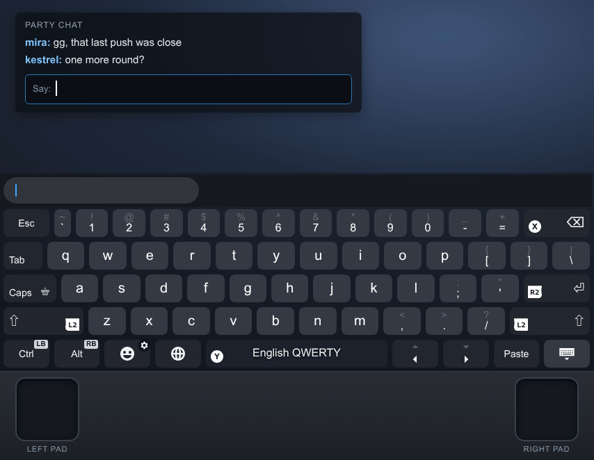
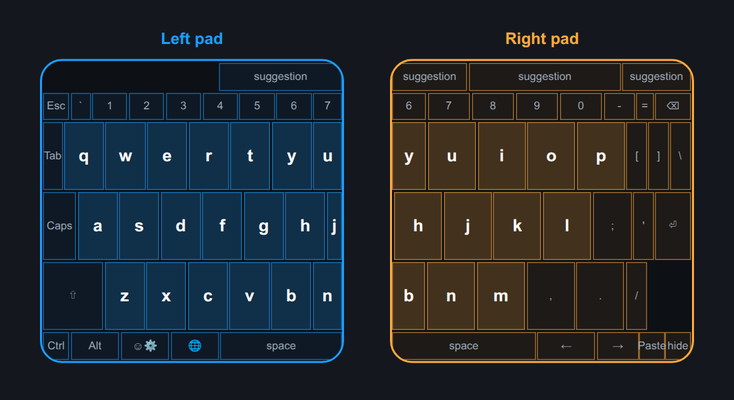
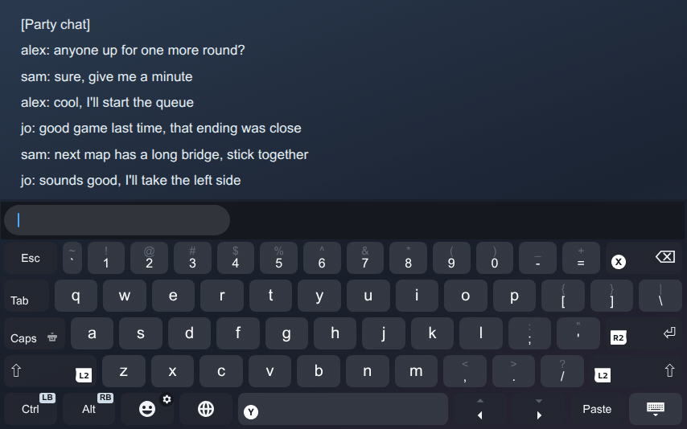
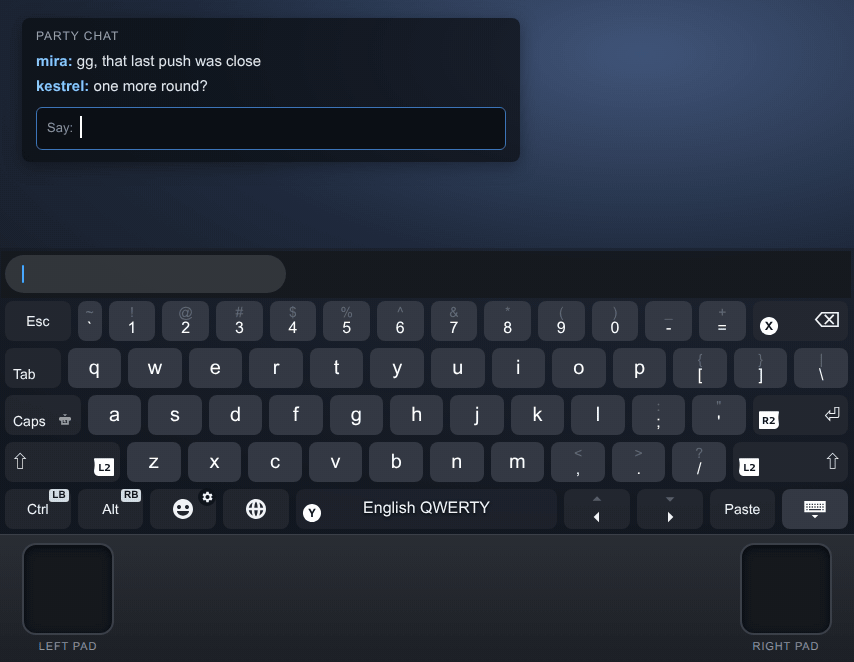
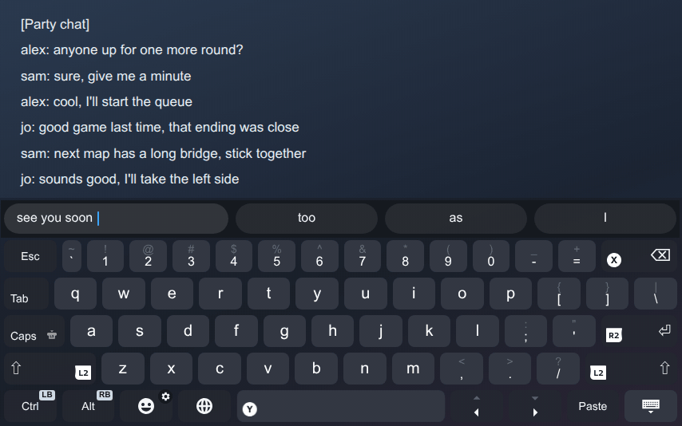
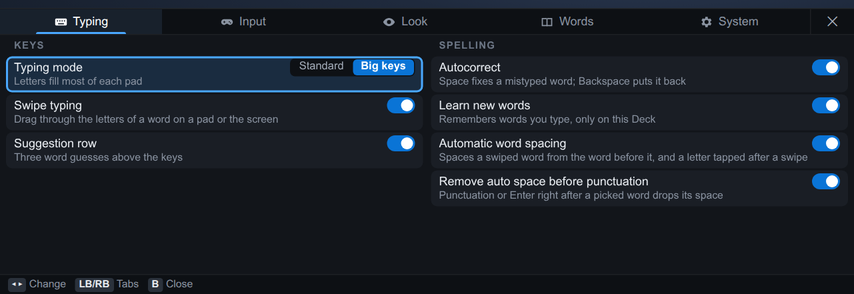

# VaporType

Swipe typing, word suggestions, autocorrect and Esc / Ctrl / Alt keys for the Steam Deck's own on-screen keyboard.
It is a [Decky Loader](https://github.com/SteamDeckHomebrew/decky-loader) plugin.

The strip under the keyboard in these clips is not part of VaporType: it shows where each thumb is on its pad and
when the pad is clicked.

VaporType patches Steam's keyboard while Steam runs, so a Steam update can break it. If the keyboard code it needs
has changed, it turns itself off and Steam's keyboard works as before. It also fixes a Steam bug that makes
trackpad typing slower each time the keyboard opens.

## Install

Needs [Decky Loader](https://decky.xyz/) 3.0 or newer.

1. **...** → Decky → gear icon → General → turn on **Developer mode**.
2. Developer → **Install Plugin from URL**: enter `https://dmitrii-galantsev.github.io/VaporType/VaporType.zip`,
   press **Install** and confirm.
3. Open the keyboard (**STEAM + X**) and answer the first-use card.

Install the same URL again to update. Learned words and settings are kept.

## Where the keys are on each pad

Each pad covers its own side of the keyboard, and both reach the middle keys Y U H J B N. The three letter rows fill
70 % of each pad's height and the other rows are pushed to its edges, so a letter is about 7.6 mm tall on the pad
instead of 5.3 mm.

To change this, hold the emoji key for settings:

- Input → **Pad reach**: **Past middle** gives each pad three quarters of the keyboard, **Whole** lets either thumb
  swipe any word, and **Right only** puts the whole keyboard on the right pad for one-handed typing.
- Typing → **Typing mode**: **Standard** maps the pads as Steam does, without the taller letters.

## Swiping

Click a pad on the first letter and keep it pressed, slide through the rest of the letters, and let go. VaporType
types the word and puts a space between it and the word before.

A word with letters on both halves uses both pads: keep the first pad pressed while the other pad clicks or slides
over its letters. The word ends when neither pad is pressed. In the clip above, the right pad holds H, the left pad
clicks E, and the right pad slides on to L and O.

Backspace right after a swipe deletes the whole word. Swiping also works with a finger on the touchscreen.

## Tapping and autocorrect

Click a pad on a key to type it, or touch the screen. The left word in the suggestion row is what you typed. When the
middle one is blue, Space replaces your word with it. Backspace right after a correction puts back what you typed.

## Suggestions

Pick a suggestion with a pad click, a touch, or the D-pad and A. It replaces the letters you typed and adds a space.

## Moving the cursor

Click Space and keep it pressed, then slide left or right. The cursor moves with your thumb; let go where you want
to type.

## Other keys

- **Esc** is left of the number row; **Ctrl** and **Alt** are at the bottom left. Tap Ctrl or Alt once for the next
  key only, twice to keep it on, a third time to turn it off. Hold LB for Ctrl, RB for Alt.
- **Settings**: hold the emoji key (the one with the gear).

## Privacy

Nothing leaves the Deck. Learning new words and showing the typed text above the keys stay off until you turn them
on in the first-use card.

- Learned words are kept in `~/homebrew/settings/vaportype/` and in Steam's local storage. Settings → Words lists
  them; tap one to forget it.
- VaporType can't tell a password field from any other field. Turn on **Private mode** before typing a password
  (Settings → System, or hold the typed-text line): no learning, no autocorrect, no typed text, no log.
- The typing log is off unless you turn it on (`~/homebrew/data/vaportype/typing-log.jsonl`).
- **Forget everything** (keyboard settings, or Quick Access → VaporType) deletes learned and blocked words, their
  backups and the log.

## Problems

- To get Steam's keyboard back at once: Quick Access → Decky → VaporType → turn off **Enabled**. If that panel won't
  open, disable VaporType in Decky settings → Plugins and restart the Deck.
- Swiping, suggestions and autocorrect need the English QWERTY layout. Swiping pauses while Ctrl or Alt is on. The
  back grips don't work while the keyboard is open.
- [Open an issue](https://github.com/dmitrii-galantsev/VaporType/issues/new?template=bug_report.md) with the status
  lines from the Quick Access panel and your Steam update channel.

## Uninstall

Decky settings → Plugins → VaporType → **...** → Uninstall. Learned words stay for a reinstall unless you press
**Forget everything** first.

## License

Code: MIT, see [LICENSE](LICENSE).

<!-- data-license:start -->
Word data: `words.js` CC BY-SA 4.0 (wordfreq data), with the SCOWL notices in LICENSE; `lm.js` CC BY-SA 4.0 (contains values derived from wordfreq data). Attribution and sources: [DATA-LICENSES.md](keyboard/data/DATA-LICENSES.md).
<!-- data-license:end -->
